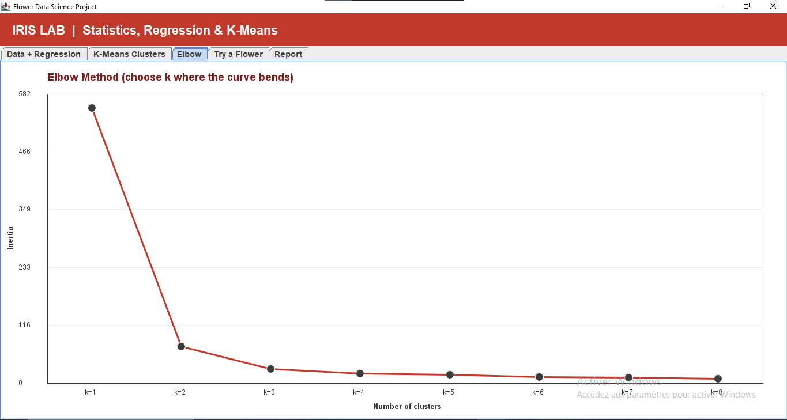
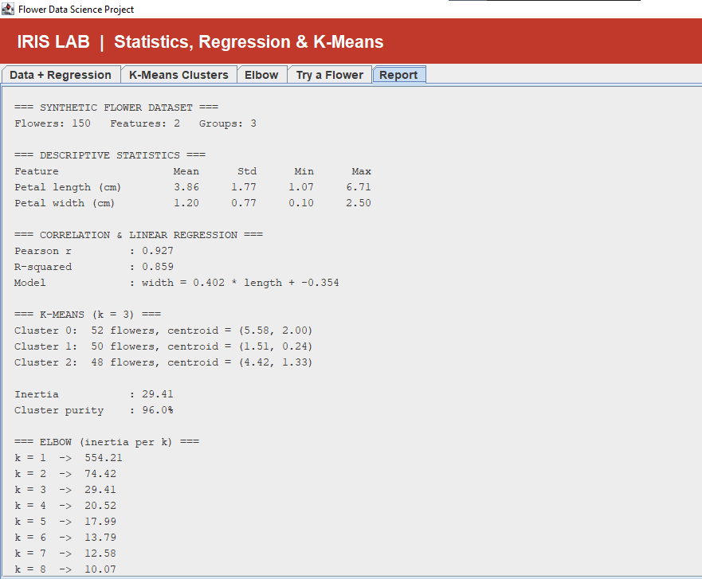

#  Iris Lab | Flower Data Analysis

### Java Swing • Data Science • K-Means Clustering

Iris Lab is a Java desktop application developed
to explore flower data through statistical analysis,
data visualization, linear regression, and
unsupervised machine learning.

The project demonstrates fundamental concepts
of data science using an interactive graphical
interface built with Java Swing.

##  Project Objectives

- Explore and visualize flower measurements.
- Understand relationships between variables.
- Apply linear regression.
- Implement K-Means clustering.
- Explore the Elbow Method.
- Build an interactive Java application.

##  Features

### 1. Data Visualization
Visualizes flower measurements using scatter
plots and a regression line.

### 2. K-Means Clustering
Groups synthetic flower observations into
three clusters based on petal measurements.

### 3. Elbow Method
Displays clustering inertia for different
values of K.

### 4. Interactive Flower Exploration
Allows users to enter petal length and width
and identify the nearest K-Means cluster.

### 5. Statistical Report
Displays descriptive statistics and
analysis results.

##  Technologies

- Java
- Java Swing
- Object-Oriented Programming
- Statistics
- Linear Regression
- K-Means Clustering
- Eclipse IDE

##  Interface Design

The application uses a red, grey, and black
color palette with an interactive tab-based
interface.

##  How to Run

1. Download or clone this repository.
2. Open Eclipse IDE.
3. Create a Java project.
4. Import the Java source files.
5. Ensure the java.desktop module is available.
6. Run Main.java as a Java Application.

##  Screenshots

### 1. Data + Regression

### 2. K-Means Clusters

### 3. Elbow Method

### 4. Try a Flower

### 5. Statistical Report

##  Project Status

Student project developed for learning and
practicing data analysis and Java programming.

The application uses synthetic flower data.
Its clustering results do not represent a
validated flower-species classifier.

##  Author

Marwa Benlyazid

Data Science & Artificial Intelligence Student

Faculté des Sciences de Rabat
